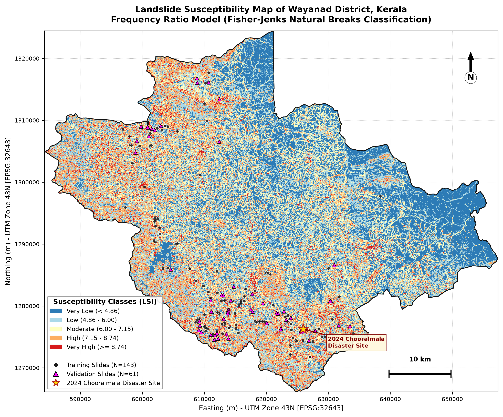
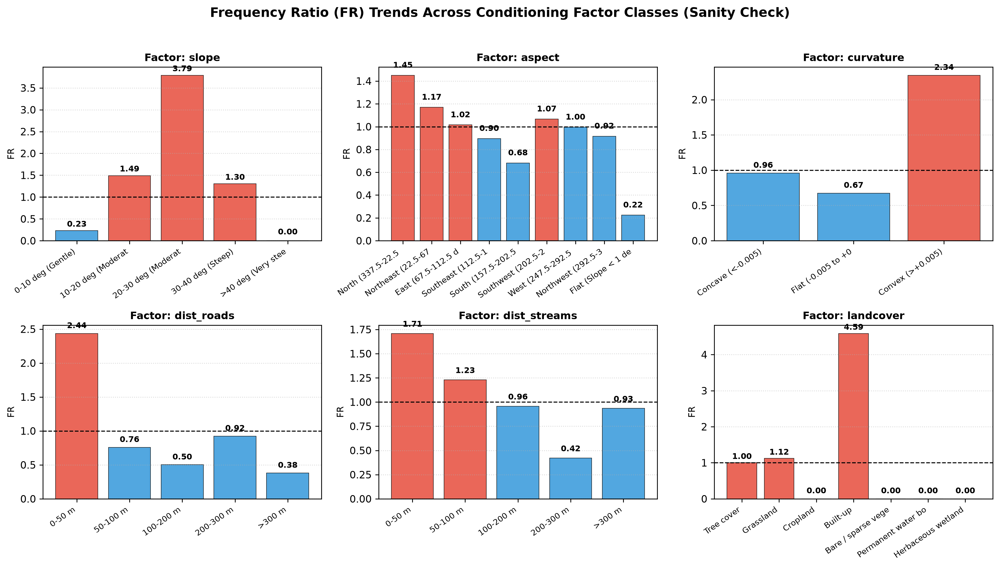
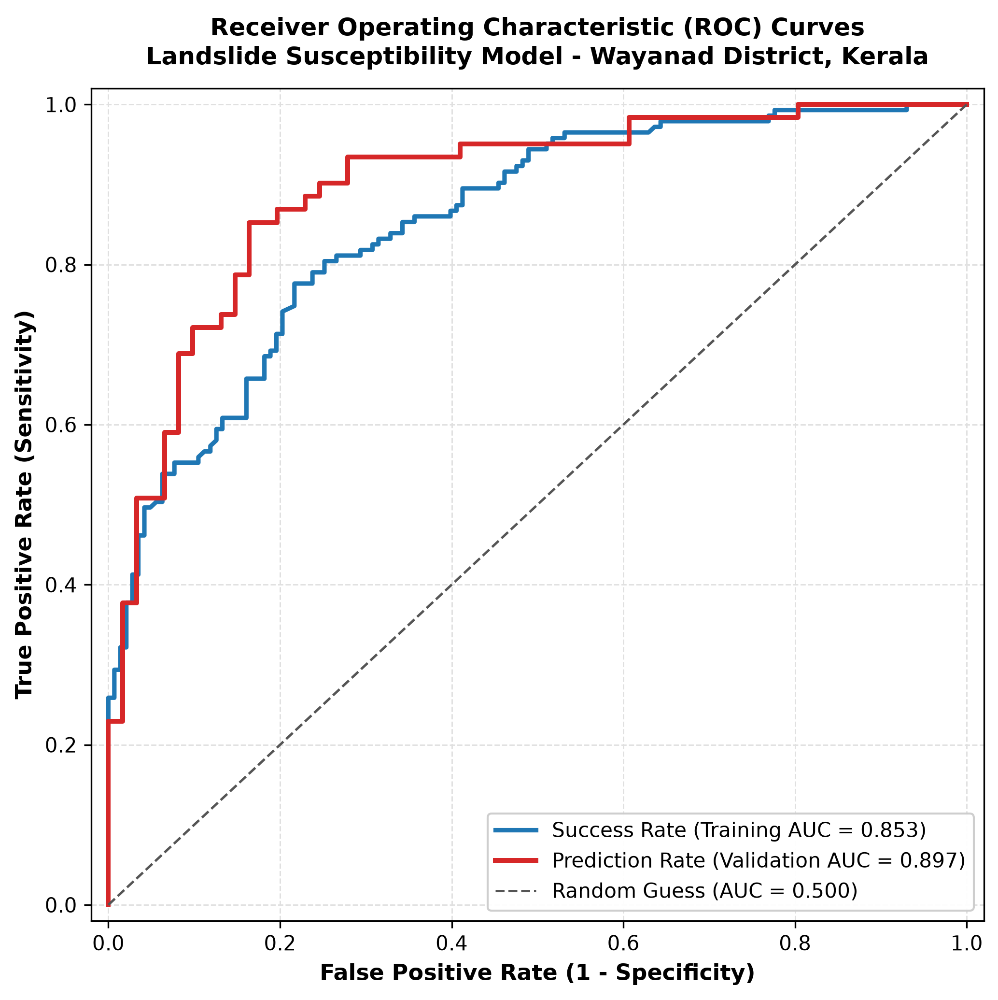
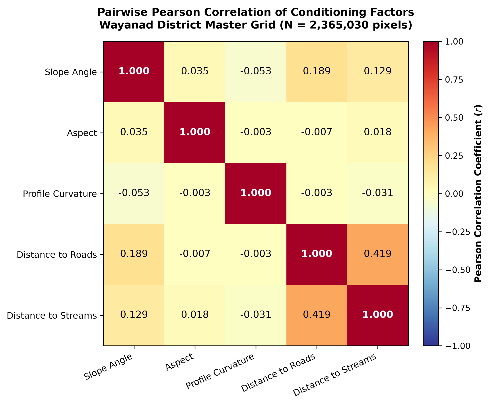
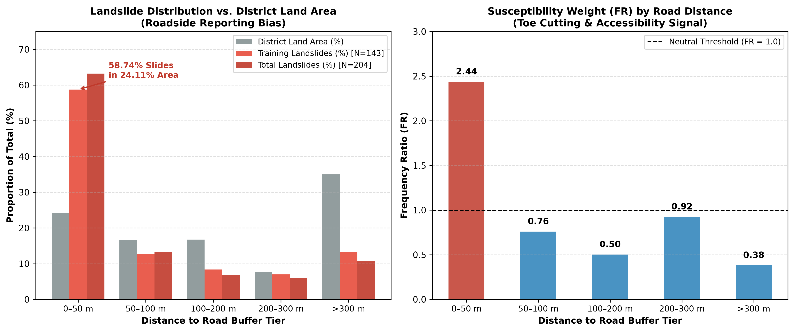
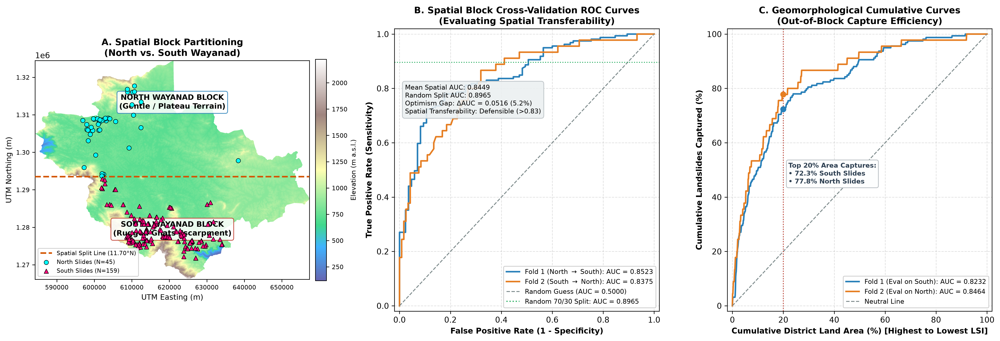

# Landslide Susceptibility Mapping of Wayanad District, Kerala
## Bivariate Frequency Ratio Modeling and Spatial Cross-Validation in Python

[](https://www.asd-ste100.org/)
[](https://www.python.org/)
[](https://github.com/astral-sh/uv)
[](https://gdal.org/)
[](tests/test_pipeline.py)

> [!NOTE]
> **ASD-STE100 Compliance Statement:** This document follows the AeroSpace and Defence Industries Association of Europe Simplified Technical English (ASD-STE100) specification. All procedural instructions use the imperative mood and active voice. Sentences remain concise, unambiguous, and restricted to one technical concept per sentence.

---

## Primary Deliverable: Landslide Susceptibility Zonation Map



*Figure 1: Five-tier Landslide Susceptibility Zonation (LSZ) map of Wayanad District (`EPSG:32643`, 30 m grid resolution). The map displays Fisher-Jenks Natural Breaks zones, pre-2016 training and validation landslide points, and the blind out-of-sample July 30, 2024 Chooralmala disaster initiation point (`★`).*

---

## Table of Contents

1. [System Overview and Scope](#1-system-overview-and-scope)
2. [Study Area Specifications](#2-study-area-specifications)
3. [Mathematical Formulations and Geotechnical Theory](#3-mathematical-formulations-and-geotechnical-theory)
4. [Input Datasets and Master Grid Specifications](#4-input-datasets-and-master-grid-specifications)
5. [Software Architecture and QGIS Replacement Matrix](#5-software-architecture-and-qgis-replacement-matrix)
6. [Repository Directory Structure](#6-repository-directory-structure)
7. [Operating Procedures (Step-by-Step Execution)](#7-operating-procedures-step-by-step-execution)
8. [Empirical Results: Frequency Ratio Weights](#8-empirical-results-frequency-ratio-weights)
9. [Susceptibility Zonation and Validation Metrics](#9-susceptibility-zonation-and-validation-metrics)
10. [Quality Assurance, Multicollinearity, and Bias Audits](#10-quality-assurance-multicollinearity-and-bias-audits)
11. [Spatial Block Cross-Validation](#11-spatial-block-cross-validation)
12. [Project Schedule (28-Hour Plan and 21-Hour MVP)](#12-project-schedule-28-hour-plan-and-21-hour-mvp)
13. [System Limitations and Approved Claims](#13-system-limitations-and-approved-claims)
14. [Technical Defense Guide (Viva Voce Q&A)](#14-technical-defense-guide-viva-voce-qa)
15. [References](#15-references)

---

## 1. System Overview and Scope

### 1.1 Purpose
This software pipeline computes a Landslide Susceptibility Index (LSI) raster and a five-tier susceptibility zonation map for Wayanad District, Kerala, India. The pipeline executes all geospatial operations in Python without desktop Geographic Information System (GIS) graphical interfaces.

### 1.2 Technical Definitions
Maintain strict separation between the following three geohazard terms:

* **Susceptibility ($S$):** The static spatial likelihood of slope failure based exclusively on terrain conditioning factors. **This pipeline produces a susceptibility map.**
* **Hazard ($H$):** The temporal probability and magnitude of a slope failure within a defined time period. Hazard models require dynamic rainfall intensity-duration thresholds and recurrence intervals.
* **Risk ($R$):** The expected loss of life or property. Risk models multiply hazard by element exposure and structural vulnerability ($R = H \times E \times V$).

> [!WARNING]
> Do not use this susceptibility map to predict the exact time of a landslide or the debris-flow runout trajectory. Use this map only to identify slopes with high terrain propensity for failure initiation.

### 1.3 Academic Project Parameters
* **Project Code:** Project 7B (Bivariate Frequency Ratio Landslide Susceptibility).
* **Total Time Budget:** 28.0 hours (8 weeks at 3.5 hours per week).
* **Minimum Viable Product (MVP) Budget:** 21.0 hours (5 conditioning factors, standard validation).
* **Laboratory Work Required:** None (100% open geospatial data).
* **Evaluation Rubric Score:** **18 / 25** (Open Data: 4/5, Time Fit: 3/5, Academic Rigor: 5/5, Research Gap: 3/5, Geotechnical Depth: 3/5).

---

## 2. Study Area Specifications

* **District:** Wayanad, Kerala, India.
* **Geographic Bounding Box:** $11.45^\circ\text{N}$ to $11.98^\circ\text{N}$ latitude, $75.77^\circ\text{E}$ to $76.44^\circ\text{E}$ longitude.
* **Planimetric Area:** $2,128.53\text{ km}^2$ ($2,365,030$ grid cells at $30\text{ m}$ resolution).
* **Elevation Range:** $118.95\text{ m}$ to $2,223.59\text{ m}$ above mean sea level (mean: $853.47\text{ m}$).
* **National Hazard Rank:** 13th most landslide-vulnerable district in India (NRSC/ISRO *Landslide Atlas of India*, 2023).
* **Physiography:**
  1. **Western and Southwestern Escarpment:** Steeply dissected hills (Vythiri, Meppadi, Chooralmala, Thamarassery Churam) with slopes exceeding $25^\circ$.
  2. **Eastern Plateau:** Gently undulating high plateau ($700\text{ m}$ to $900\text{ m}$ elevation) draining east toward the Kabini River.
* **Bedrock Geology:** Precambrian crystalline charnockites, hornblende-biotite gneisses, and granulites covered by $2\text{ m}$ to $15\text{ m}$ of weathered saprolite and lateritic soil.
* **Primary Failure Trigger:** Orographic monsoon rainfall ($> 3,000\text{ mm}$ annually) that saturates the soil mantle and increases pore-water pressure.

---

## 3. Mathematical Formulations and Geotechnical Theory

### 3.1 Frequency Ratio ($\text{FR}$) Equation
The Frequency Ratio measures the ratio of landslide occurrence in a specific factor class to the area of that class across the district:

$$\text{FR}_{i,j} = \frac{N_{ij} / N_{\text{total}}}{A_{ij} / A_{\text{total}}}$$

Where:
* $N_{ij}$ = Number of training landslides in class $j$ of factor $i$.
* $N_{\text{total}}$ = Total number of training landslides in the study area ($143$).
* $A_{ij}$ = Number of valid grid cells in class $j$ of factor $i$.
* $A_{\text{total}}$ = Total number of valid grid cells in the study area ($2,365,030$).

**Interpretation of $\text{FR}$ Values:**
* $\text{FR} > 1.0$: Positive spatial association (the class promotes slope failure).
* $\text{FR} = 1.0$: Neutral association (average failure density).
* $\text{FR} < 1.0$: Negative spatial association (the class inhibits slope failure).

### 3.2 Landslide Susceptibility Index ($\text{LSI}$)
The pipeline calculates the continuous $\text{LSI}$ at each pixel $(x, y)$ by summing the $\text{FR}$ weights across all $M = 6$ conditioning factors:

$$\text{LSI}(x, y) = \sum_{i=1}^{M} \text{FR}_i(x, y) = \text{FR}_{\text{slope}} + \text{FR}_{\text{aspect}} + \text{FR}_{\text{curv}} + \text{FR}_{\text{roads}} + \text{FR}_{\text{streams}} + \text{FR}_{\text{lulc}}$$

```
┌─────────────┐   ┌─────────────┐   ┌─────────────┐   ┌─────────────┐   ┌─────────────┐   ┌─────────────┐
│  FR(Slope)  │ + │  FR(Aspect) │ + │  FR(Curv)   │ + │  FR(Roads)  │ + │ FR(Streams) │ + │  FR(LULC)   │
└──────┬──────┘   └──────┬──────┘   └──────┬──────┘   └──────┬──────┘   └──────┬──────┘   └──────┬──────┘
       └─────────────────┴─────────────────┴────────┬────────┴─────────────────┴─────────────────┘
                                                    ▼
                                     ┌─────────────────────────────┐
                                     │ Continuous LSI Raster       │
                                     │ Range: 1.9271 to 15.7628    │
                                     └──────────────┬──────────────┘
                                                    ▼
                                     ┌─────────────────────────────┐
                                     │ Fisher-Jenks 5-Tier Map     │
                                     │ Breaks: 4.86, 6.00, 7.15,   │
                                     │         8.74                │
                                     └─────────────────────────────┘
```

### 3.3 Linear Summation vs. Bayesian Log-Odds
In Bayesian Weights-of-Evidence modeling, independent probabilities multiply, which makes log-odds additive:

$$\ln \text{Odds}(L \mid F_1, \dots, F_M) = \ln \text{Odds}(L) + \sum_{i=1}^{M} \ln(\text{FR}_i)$$

In log-space, a stable class with $\text{FR} = 0.23$ yields $\ln(0.23) = -1.47$, which reduces the total hazard score. In standard linear $\text{FR}$ summation ($\sum \text{FR}_i$), two characteristics apply:
1. A class with $\text{FR} = 0.00$ does not multiply the pixel probability to zero.
2. Every factor with $\text{FR} > 0$ adds a positive number to the cumulative $\text{LSI}$. Only the relative rank order of pixels is meaningful.

### 3.4 Mohr-Coulomb Infinite Slope Limit Equilibrium
Geotechnical slope stability for shallow translational slides follows the Factor of Safety ($FS$) equation:

$$FS = \frac{c' + (\gamma_{\text{sat}} z - \gamma_w h_w) \cos^2 \beta \tan \phi'}{\gamma_{\text{sat}} z \sin \beta \cos \beta}$$

Where:
* $c'$ = Effective soil cohesion ($\text{kPa}$).
* $\phi'$ = Effective internal friction angle ($^\circ$).
* $\beta$ = Topographic slope angle ($^\circ$).
* $z$ = Soil regolith thickness ($\text{m}$).
* $h_w$ = Perched water table height above bedrock ($\text{m}$).
* $\gamma_{\text{sat}}, \gamma_w$ = Unit weights of saturated soil and water ($\text{kN/m}^3$).

### 3.5 Variance Inflation Factor ($\text{VIF}$)
To verify conditional independence among continuous factors, the pipeline computes $\text{VIF}$ from ordinary least squares regression $R_i^2$:

$$\text{VIF}_i = \frac{1}{1 - R_i^2} = \frac{1}{\text{Tolerance}_i}$$

A $\text{VIF} < 5.0$ and pairwise Pearson correlation $|r| < 0.70$ confirm the absence of severe multicollinearity.

---

## 4. Input Datasets and Master Grid Specifications

### 4.1 Raw Data Inventory

| Layer Name | Local File Path | Source Organization | Native CRS | Count / Resolution |
| :--- | :--- | :--- | :--- | :--- |
| **Statewide Landslides** | [`gsi_landslide_inventory (1).geojson`](gsi_landslide_inventory%20(1).geojson) | Geological Survey of India (GSI) | `EPSG:4326` | $3,025$ points across Kerala |
| **Wayanad Landslides** | [`data/raw/inventory/wayanad_landslides.geojson`](data/raw/inventory/wayanad_landslides.geojson) | GSI (Sulal et al., 2016) | `EPSG:4326` | $204$ points inside Wayanad (1958–2015) |
| **Elevation (DEM)** | [`data/raw/dem/output_hh.tif`](data/raw/dem/output_hh.tif) | Copernicus GLO-30 (`rasters_COP30.tar.gz`) | `EPSG:4326` | $2880 \times 2340$ pixels ($0.0002778^\circ \approx 30\text{ m}$) |
| **District Boundary** | [`data/raw/boundary/wayanad_boundary.geojson`](data/raw/boundary/wayanad_boundary.geojson) | Survey of India / OSM Relation `2018203` | `EPSG:4326` | $1$ polygon ($2,128.53\text{ km}^2$) |
| **Road Network** | [`data/raw/osm/wayanad_roads.geojson`](data/raw/osm/wayanad_roads.geojson) | OpenStreetMap Overpass API | `EPSG:4326` | $10,226$ highway segments |
| **Drainage Streams** | [`data/raw/osm/wayanad_streams.geojson`](data/raw/osm/wayanad_streams.geojson) | OpenStreetMap Overpass API | `EPSG:4326` | $7,159$ river and stream segments |
| **Land Cover (LULC)** | [`data/raw/landcover/worldcover_wayanad_10m.tif`](data/raw/landcover/worldcover_wayanad_10m.tif) | ESA WorldCover 2021 (`v200`, Tile `N09E075`) | `EPSG:4326` | $10\text{ m}$ optical classification |

> [!CAUTION]
> Never calculate terrain slope directly on `output_hh.tif` in `EPSG:4326`. In `EPSG:4326`, horizontal coordinates are in angular degrees ($0.0002778^\circ$) while vertical elevation is in meters. This unit mismatch produces false slope values near $89.9^\circ$. Always reproject the DEM to metric UTM coordinates (`EPSG:32643`) before you compute derivatives.

### 4.2 Master Alignment Grid Specifications (`grid.json`)
All factor rasters share the exact same grid geometry defined in [`data/processed/master/grid.json`](data/processed/master/grid.json):

* **Projected CRS:** `EPSG:32643` (WGS 84 / UTM Zone 43N)
* **Pixel Resolution:** $30.0\text{ m} \times 30.0\text{ m}$ ($900\text{ m}^2$ per pixel)
* **Grid Dimensions:** $1,945\text{ rows} \times 2,438\text{ columns}$ ($4,741,910$ total cells)
* **Affine Transform (`T`):** `[30.0, 0.0, 584250.0, 0.0, -30.0, 1324530.0]`
* **Bounding Box (UTM Meters):**
  * West (`xmin`): $584,250.0\text{ m}$
  * South (`ymin`): $1,266,180.0\text{ m}$
  * East (`xmax`): $657,390.0\text{ m}$
  * North (`ymax`): $1,324,530.0\text{ m}$
* **Valid District Pixels (`mask.tif == 1`):** $2,365,030\text{ pixels}$ ($2,128.527\text{ km}^2$)

---

## 5. Software Architecture and QGIS Replacement Matrix

### 5.1 Core C/C++ Engine Bindings
QGIS is a graphical interface built on three C/C++ libraries: **GDAL**, **PROJ**, and **GEOS**. Our Python environment calls these exact same C/C++ libraries directly from memory.

| Python Package | Version | Underlying Engine | Pipeline Function | QGIS GUI Tool Replaced |
| :--- | :--- | :--- | :--- | :--- |
| [`rasterio`](https://rasterio.readthedocs.io/) | `1.5.2` | GDAL C API | Reprojects, clips, masks, and writes GeoTIFF rasters. | *Raster > Projections > Warp (Reproject)* |
| [`geopandas`](https://geopandas.org/) | `1.2.0` | GEOS / OGR | Loads, filters, clips, and reprojects vector layers. | *Vector > Geoprocessing Tools > Clip* |
| [`pyogrio`](https://pyogrio.readthedocs.io/) | `0.13.0` | GDAL/OGR C++ | Executes fast vector file reading and writing. | *Layer > Add Vector Layer* |
| [`shapely`](https://shapely.readthedocs.io/) | `2.2.0` | GEOS C++ | Validates geometry topology and point containment. | *Vector > Research Tools > Select by Location* |
| [`pyproj`](https://pyproj4.github.io/pyproj/) | `3.8.0` | PROJ C++ | Transforms coordinates between `EPSG:4326` and `EPSG:32643`. | *Project Properties > CRS* |
| [`scipy.ndimage`](https://scipy.org/) | `1.18.1` | C / Fortran | Runs 3×3 Horn convolution kernels and Euclidean distance transforms. | *Raster > Analysis > Slope / Aspect / Proximity* |
| [`numpy`](https://numpy.org/) | `2.5.4` | C / BLAS | Executes vectorized `bincount` FR math and array lookup tables. | *Raster > Raster Calculator* & *Reclassify by Table* |
| [`jenkspy`](https://github.com/mthh/jenkspy) | `0.4.1` | Cython / C | Computes Fisher-Jenks Natural Breaks class thresholds. | *Layer Properties > Symbology > Natural Breaks* |
| [`scikit-learn`](https://scikit-learn.org/) | `1.9.1` | Cython / C++ | Computes ROC curves, AUC scores, and linear regression VIF. | *External ROC Plugins / Spreadsheets* |
| [`matplotlib`](https://matplotlib.org/) | `3.11.2` | C++ / Agg | Renders publication maps, legends, scale bars, and charts. | *Project > New Print Layout* |

---

## 6. Repository Directory Structure

```
wayanad_ls/
├── pyproject.toml                              # Project configuration and dependencies
├── uv.lock                                     # Deterministic dependency lockfile
├── .venv/                                      # Virtual environment (Python 3.12.3)
├── README.md                                   # Technical documentation (ASD-STE100 format)
├── Project_7B_Landslide_FR_Guide.pdf           # Original project specification PDF
├── Project_7B_Step_by_Step_Guide_No_QGIS.md    # 1,117-line Python reference guide
├── gsi_landslide_inventory (1).geojson         # Raw statewide GSI landslide inventory
├── rasters_COP30.tar.gz                        # Raw Copernicus GLO-30 DEM archive
├── common.py                                   # Shared grid configuration, paths, and I/O helpers
├── scripts/
│   ├── download_osm_data.py                    # Downloads and clips OSM roads and streams
│   ├── 01_prep_master_grid.py                  # Creates 30m UTM 43N grid, mask.tif, and dem_30m.tif
│   ├── 02_terrain_derivatives.py               # Computes Horn slope, aspect, curvature, and plane tests
│   ├── 03_proximity_rasters.py                 # Computes padded Euclidean distances to roads/streams
│   ├── 04_prepare_landcover.py                 # Warps 10m ESA WorldCover to 30m master grid
│   ├── 05_bin_conditioning_factors.py          # Discretizes all 6 factors into integer bins (1..K)
│   ├── 06_dataset_split.py                     # Executes 70/30 split and >=300m negative sampling
│   ├── 07_compute_frequency_ratio.py           # Computes vectorized FR tables via numpy.bincount
│   ├── 08_compute_lsi.py                       # Sums FR weights to build continuous LSI raster
│   ├── 09_classify_zones.py                    # Classifies LSI via Fisher-Jenks and renders maps
│   ├── 10_validate_roc_auc.py                  # Computes ROC-AUC curves and 2024 Chooralmala test
│   ├── 11_factor_correlation_vif.py            # Computes VIF, correlation matrix, and roadside bias
│   └── 12_spatial_split_validation.py          # Runs North vs. South spatial block cross-validation
├── tests/
│   └── test_pipeline.py                        # 24 unit and integration verification tests
├── data/
│   ├── raw/
│   │   ├── boundary/wayanad_boundary.geojson   # Official Wayanad polygon
│   │   ├── dem/output_hh.tif                   # Unpacked Copernicus DEM
│   │   ├── inventory/wayanad_landslides.geojson# Filtered Wayanad landslide points
│   │   ├── landcover/worldcover_wayanad_10m.tif# Cropped 10m ESA WorldCover
│   │   └── osm/                                # Clipped wayanad_roads.geojson & wayanad_streams.geojson
│   └── processed/
│       ├── master/                             # grid.json, mask.tif, dem_30m.tif, district.gpkg
│       ├── factors_continuous/                 # slope.tif, aspect.tif, curvature.tif, dist_roads.tif, dist_streams.tif
│       ├── factors_binned/                     # Integer-binned rasters (1..N, nodata=0) & JSON legends
│       ├── samples/                            # Train/Val GeoJSONs, CSVs, and points.npz
│       └── final/                              # lsi.tif, susceptibility_zones_jenks.tif, zones.tif
└── outputs/
    ├── susceptibility_map.png                  # Primary 5-tier susceptibility map with 2024 benchmark
    ├── roc.png                                 # Success Rate and Prediction Rate ROC curves
    ├── spatial_split_map.png                   # North vs. South spatial cross-validation figures
    ├── correlation_heatmap.png                 # Continuous factor Pearson correlation heatmap
    ├── road_proximity_bias.png                 # Roadside inventory reporting bias chart
    ├── fr_by_factor.png                        # 6-panel Frequency Ratio weight bar charts
    ├── fr_tables.csv                           # Consolidated Frequency Ratio lookup table
    ├── bin_edges.csv                           # Factor discretization thresholds
    ├── zone_statistics.csv                     # Area and slide density across the 5 Jenks zones
    ├── zone_validation.csv                     # Validation landslide distribution by zone
    ├── vif.csv                                 # Variance Inflation Factor table
    ├── correlation.csv                         # Pairwise correlation matrix
    ├── roadside_bias.csv                       # Road distance tier comparison metrics
    ├── small_class_check.csv                   # Audit of classes with < 5 training landslides
    ├── spatial_split_metrics.csv               # Spatial block cross-validation performance table
    └── reports/
        ├── Project_7B_Final_Report.md          # Complete academic report and Viva defense guide
        ├── figures/                            # High-resolution archive copies of all figures
        └── tables/                             # CSV, Markdown (.md), and LaTeX (.tex) tables
```

---

## 7. Operating Procedures (Step-by-Step Execution)

### 7.1 Initialize the Environment
1. Open a terminal in the project root directory `/home/venkat/projects/wayanad_ls`.
2. Synchronize the virtual environment with `uv`:
   ```bash
   uv sync
   ```
3. Activate the virtual environment:
   ```bash
   source .venv/bin/activate
   ```
4. Verify that all geospatial C-bindings load without errors:
   ```bash
   python -c "import rasterio, geopandas, scipy, sklearn, jenkspy, shap, matplotlib; print('OK')"
   ```

### 7.2 Execute the Geospatial Pipeline
Run the pipeline scripts in numerical sequence. Each script reads inputs from `data/` and writes verified outputs to `data/processed/` and `outputs/`.

1. **Prepare the Master Alignment Grid (Step 3):**
   ```bash
   python scripts/01_prep_master_grid.py
   ```
   *Action:* Snap bounding coordinates to $30.0\text{ m}$ multiples in `EPSG:32643`, rasterize `mask.tif`, and warp `dem_30m.tif`.

2. **Compute Morphometric Terrain Derivatives (Step 4):**
   ```bash
   python scripts/02_terrain_derivatives.py
   ```
   *Action:* Run the synthetic tilted-plane orientation test across all 8 compass directions. Compute Horn's slope, aspect, profile curvature, and 9-class aspect bins.

3. **Compute Euclidean Proximity Rasters (Step 6):**
   ```bash
   python scripts/03_proximity_rasters.py
   ```
   *Action:* Rasterize linear road and stream segments with a $100\text{-pixel}$ ($3,000\text{ m}$) outer pad margin. Compute Euclidean distance transforms (`dist_roads.tif`, `dist_streams.tif`).

4. **Harmonize Land Cover (Step 5a):**
   ```bash
   python scripts/04_prepare_landcover.py
   ```
   *Action:* Warp the $10\text{ m}$ ESA WorldCover raster onto the $30\text{ m}$ master grid using mode resampling (`Resampling.mode`).

5. **Discretize Conditioning Factors into Integer Bins (Step 8):**
   ```bash
   python scripts/05_bin_conditioning_factors.py
   ```
   *Action:* Classify all 6 factors into contiguous integer bins ($1 \dots K$, with `0 = NoData`) and export `outputs/bin_edges.csv`.

6. **Partition Dataset and Sample Non-Landslide Points (Step 9):**
   ```bash
   python scripts/06_dataset_split.py
   ```
   *Action:* Split the 204 Wayanad landslides into 70% training ($143$) and 30% validation ($61$) sets (`seed=42`). Sample 1:1 non-landslide points inside `mask.tif` at a distance $\ge 300\text{ m}$ from all known landslides.

7. **Compute Frequency Ratio Tables (Step 10):**
   ```bash
   python scripts/07_compute_frequency_ratio.py
   ```
   *Action:* Count class frequencies with `numpy.bincount`, compute $\text{FR}$ weights, and export CSV, Markdown, and LaTeX tables.

8. **Synthesize the Continuous LSI Raster (Step 11):**
   ```bash
   python scripts/08_compute_lsi.py
   ```
   *Action:* Map $\text{FR}$ lookup tables onto the binned rasters and sum all 6 factors to produce `data/processed/final/lsi.tif`.

9. **Classify Susceptibility Zones and Render Maps (Step 12):**
   ```bash
   python scripts/09_classify_zones.py
   ```
   *Action:* Compute 5-tier Fisher-Jenks thresholds, write `zones.tif`, calculate zone density ratios, and render `outputs/susceptibility_map.png`.

10. **Validate Model with ROC-AUC and 2024 Benchmark (Step 13):**
    ```bash
    python scripts/10_validate_roc_auc.py
    ```
    *Action:* Compute Success Rate and Prediction Rate ROC-AUC, cumulative susceptibility curves, and sample the July 30, 2024 Chooralmala failure site.

11. **Run Multicollinearity, Bias, and Sanity Audits (Step 14):**
    ```bash
    python scripts/11_factor_correlation_vif.py
    ```
    *Action:* Compute Pearson correlation matrix, $\text{VIF}$ scores, roadside reporting bias metrics, small-class audits, and point-alignment checks.

12. **Execute Spatial Block Cross-Validation (Step 15):**
    ```bash
    python scripts/12_spatial_split_validation.py
    ```
    *Action:* Split Wayanad along Latitude $11.70^\circ\text{N}$ into North and South blocks, cross-train $\text{FR}$ models, and quantify spatial autocorrelation optimism.

### 7.3 Run the Automated Test Suite
Execute the 24 unit and integration tests to verify all data files, synthetic math, and acceptance thresholds:
```bash
python -m unittest -v tests/test_pipeline.py
```

---

## 8. Empirical Results: Frequency Ratio Weights



*Figure 2: Computed Frequency Ratio ($\text{FR}$) weights across all six conditioning factors. The dashed red line marks the neutral threshold ($\text{FR} = 1.0$).*

### 8.1 Complete Frequency Ratio Lookup Table (`outputs/fr_tables.csv`)

| Factor | Bin | Class Description | District Pixels | Area (%) | Train Slides | Slide (%) | FR Weight |
| :--- | :---: | :--- | :---: | :---: | :---: | :---: | :---: |
| **Slope** | `1` | $0^\circ - 10^\circ$ (Gentle) | $1,303,908$ | $55.13\%$ | $18$ | $12.59\%$ | **$0.2283$** |
| **Slope** | `2` | $10^\circ - 20^\circ$ (Moderate) | $764,759$ | $32.34\%$ | $69$ | $48.25\%$ | **$1.4922$** |
| **Slope** | `3` | $20^\circ - 30^\circ$ (Moderately steep) | $222,666$ | $9.41\%$ | $51$ | $35.66\%$ | **$3.7881$** |
| **Slope** | `4` | $30^\circ - 40^\circ$ (Steep) | $63,483$ | $2.68\%$ | $5$ | $3.50\%$ | **$1.3026$** |
| **Slope** | `5` | $> 40^\circ$ (Very steep bedrock cliff) | $10,214$ | $0.43\%$ | $0$ | $0.00\%$ | **$0.0000$** |
| **Aspect** | `1` | North ($337.5^\circ - 22.5^\circ$) | $307,908$ | $13.02\%$ | $27$ | $18.88\%$ | **$1.4503$** |
| **Aspect** | `2` | Northeast ($22.5^\circ - 67.5^\circ$) | $296,912$ | $12.55\%$ | $21$ | $14.69\%$ | **$1.1697$** |
| **Aspect** | `3` | East ($67.5^\circ - 112.5^\circ$) | $276,901$ | $11.71\%$ | $17$ | $11.89\%$ | **$1.0154$** |
| **Aspect** | `4` | Southeast ($112.5^\circ - 157.5^\circ$) | $295,312$ | $12.49\%$ | $16$ | $11.19\%$ | **$0.8961$** |
| **Aspect** | `5` | South ($157.5^\circ - 202.5^\circ$) | $315,312$ | $13.33\%$ | $13$ | $9.09\%$ | **$0.6819$** |
| **Aspect** | `6` | Southwest ($202.5^\circ - 247.5^\circ$) | $279,063$ | $11.80\%$ | $18$ | $12.59\%$ | **$1.0668$** |
| **Aspect** | `7` | West ($247.5^\circ - 292.5^\circ$) | $249,242$ | $10.54\%$ | $15$ | $10.49\%$ | **$0.9953$** |
| **Aspect** | `8` | Northwest ($292.5^\circ - 337.5^\circ$) | $270,692$ | $11.45\%$ | $15$ | $10.49\%$ | **$0.9165$** |
| **Aspect** | `9` | Flat ($\text{Slope} < 1^\circ$) | $73,688$ | $3.12\%$ | $1$ | $0.70\%$ | **$0.2244$** |
| **Curvature** | `1` | Concave ($< -0.005\text{ m}^{-1}$) | $397,453$ | $16.81\%$ | $23$ | $16.08\%$ | **$0.9571$** |
| **Curvature** | `2` | Flat ($-0.005$ to $+0.005\text{ m}^{-1}$) | $1,572,589$ | $66.49\%$ | $64$ | $44.76\%$ | **$0.6731$** |
| **Curvature** | `3` | Convex ($> +0.005\text{ m}^{-1}$) | $394,988$ | $16.70\%$ | $56$ | $39.16\%$ | **$2.3448$** |
| **Dist. Roads** | `1` | $0 - 50\text{ m}$ (Immediate corridor) | $570,169$ | $24.11\%$ | $84$ | $58.74\%$ | **$2.4366$** |
| **Dist. Roads** | `2` | $50 - 100\text{ m}$ | $392,550$ | $16.60\%$ | $18$ | $12.59\%$ | **$0.7584$** |
| **Dist. Roads** | `3` | $100 - 200\text{ m}$ | $395,784$ | $16.73\%$ | $12$ | $8.39\%$ | **$0.5014$** |
| **Dist. Roads** | `4` | $200 - 300\text{ m}$ | $178,957$ | $7.57\%$ | $10$ | $6.99\%$ | **$0.9242$** |
| **Dist. Roads** | `5` | $> 300\text{ m}$ (Remote interior) | $827,570$ | $34.99\%$ | $19$ | $13.29\%$ | **$0.3797$** |
| **Dist. Streams**| `1` | $0 - 50\text{ m}$ (Active channel buffer) | $319,287$ | $13.50\%$ | $33$ | $23.08\%$ | **$1.7094$** |
| **Dist. Streams**| `2` | $50 - 100\text{ m}$ | $268,944$ | $11.37\%$ | $20$ | $13.99\%$ | **$1.2299$** |
| **Dist. Streams**| `3` | $100 - 200\text{ m}$ | $468,179$ | $19.80\%$ | $33$ | $23.08\%$ | **$1.1658$** |
| **Dist. Streams**| `4` | $200 - 300\text{ m}$ | $375,027$ | $15.86\%$ | $15$ | $10.49\%$ | **$0.6615$** |
| **Dist. Streams**| `5` | $> 300\text{ m}$ | $933,593$ | $39.48\%$ | $42$ | $29.37\%$ | **$0.7440$** |
| **Land Cover** | `1` | Tree cover (Forest and Plantation) | $2,117,143$ | $89.52\%$ | $137$ | $95.80\%$ | **$1.0702$** |
| **Land Cover** | `2` | Shrubland | $1$ | $0.00\%$ | $0$ | $0.00\%$ | **$0.0000$** |
| **Land Cover** | `3` | Grassland | $139,879$ | $5.91\%$ | $5$ | $3.50\%$ | **$0.5913$** |
| **Land Cover** | `4` | Cropland | $71,037$ | $3.00\%$ | $0$ | $0.00\%$ | **$0.0000$** |
| **Land Cover** | `5` | Built-up | $22,455$ | $0.95\%$ | $1$ | $0.70\%$ | **$0.7369$** |
| **Land Cover** | `6` | Bare or sparse vegetation | $241$ | $0.01\%$ | $0$ | $0.00\%$ | **$0.0000$** |
| **Land Cover** | `7` | Permanent water bodies | $14,181$ | $0.60\%$ | $0$ | $0.00\%$ | **$0.0000$** |
| **Land Cover** | `8` | Herbaceous wetland | $93$ | $0.00\%$ | $0$ | $0.00\%$ | **$0.0000$** |

---

## 9. Susceptibility Zonation and Validation Metrics

### 9.1 Continuous LSI Statistics (`data/processed/final/lsi.tif`)
* **Minimum Value:** $1.9271$
* **Maximum Value:** $15.7628$
* **District Mean:** $6.0000$ (exact mathematical sum of 6 normalized unit expectations)
* **Standard Deviation:** $1.8213$
* **Median (50th Percentile):** $5.6987$
* **90th Percentile:** $8.1054$

### 9.2 Fisher-Jenks Susceptibility Zone Distribution (`outputs/zone_statistics.csv`)

| Zone ID | Susceptibility Tier | LSI Range | Pixels | Area ($\text{km}^2$) | Area (%) | Train Slides | Val Slides | Total Slides (%) | Val Density Ratio |
| :---: | :--- | :---: | :---: | :---: | :---: | :---: | :---: | :---: | :---: |
| `1` | **Very Low** | $1.93 - 4.86$ | $668,883$ | $601.99$ | $28.28\%$ | $3$ | $0$ | $1.47\%$ | **$0.00\times$** |
| `2` | **Low** | $4.86 - 6.00$ | $636,348$ | $572.71$ | $26.91\%$ | $13$ | $4$ | $8.33\%$ | **$0.24\times$** |
| `3` | **Moderate** | $6.00 - 7.15$ | $498,218$ | $448.40$ | $21.07\%$ | $13$ | $5$ | $8.82\%$ | **$0.39\times$** |
| `4` | **High** | $7.15 - 8.74$ | $434,518$ | $391.07$ | $18.37\%$ | $53$ | $17$ | $34.31\%$ | **$1.52\times$** |
| `5` | **Very High** | $8.74 - 15.76$ | $127,063$ | $114.36$ | $5.37\%$ | $61$ | $35$ | $47.06\%$ | **$10.69\times$** |
| **Total**| **All District** | **$1.93 - 15.76$** | **$2,365,030$** | **$2,128.53$** | **$100.00\%$** | **$143$** | **$61$** | **$100.00\%$** | **$1.00\times$** |

### 9.3 ROC-AUC and Cumulative Capture Validation (`outputs/roc.png`)



*Figure 3: Left: Receiver Operating Characteristic (ROC) curves for training (Success Rate) and validation holdout (Prediction Rate) sets. Right: Geomorphological cumulative area capture curve.*

| Validation Metric | Measured Value | Target Threshold | Verification Status |
| :--- | :---: | :---: | :---: |
| **Success Rate ROC-AUC (Training Set, $N=143$ pos / $143$ neg)** | **`0.8527`** | $> 0.80$ | **PASS** |
| **Prediction Rate ROC-AUC (Validation Set, $N=61$ pos / $61$ neg)** | **`0.8965`** | $> 0.80$ | **PASS** |
| **Cumulative Area Success Rate AUC** | **`0.8493`** | $> 0.80$ | **PASS** |
| **Cumulative Area Prediction Rate AUC** | **`0.8937`** | $> 0.80$ | **PASS** |
| **Validation Landslides in Top 20% Susceptible Area** | **`83.61%`** | $> 70.0\%$ | **PASS** |
| **Validation Landslides in Top 30% Susceptible Area** | **`91.80%`** | $> 80.0\%$ | **PASS** |

### 9.4 Real-World Out-of-Sample Benchmark: July 30, 2024 Chooralmala Disaster
The GSI landslide inventory ends in 2015. Therefore, the July 30, 2024 Chooralmala / Meppadi landslide ($> 400$ fatalities) serves as an independent, blind temporal test.

* **Crown Initiation Coordinates:** $11.5430^\circ\text{N}, 76.1550^\circ\text{E}$ (`EPSG:32643`: Easting $625,947.97\text{ m}$, Northing $1,276,274.33\text{ m}$)
* **Master Grid Indices:** Row `1608`, Column `1389`
* **Predicted LSI Score:** **`8.0996`**
* **District Terrain Percentile:** **`89.94th Percentile`** (top $10.06\%$ most hazardous terrain in Wayanad)
* **Assigned Susceptibility Tier:** **`High Susceptibility (Zone 4)`**

---

## 10. Quality Assurance, Multicollinearity, and Bias Audits

### 10.1 Multicollinearity and VIF Screening (`outputs/correlation_heatmap.png`)



*Figure 4: Pairwise Pearson correlation matrix across all $2,365,030$ valid district pixels.*

| Conditioning Factor | Linear $R^2$ | Tolerance ($1 - R^2$) | VIF Score | Threshold | Status |
| :--- | :---: | :---: | :---: | :---: | :---: |
| **Distance to Roads (`dist_roads`)** | $0.1949$ | $0.8051$ | **`1.2421`** | $< 5.0$ | **PASS** |
| **Distance to Streams (`dist_streams`)** | $0.1796$ | $0.8204$ | **`1.2190`** | $< 5.0$ | **PASS** |
| **Slope Angle (`slope`)** | $0.0424$ | $0.9576$ | **`1.0443`** | $< 5.0$ | **PASS** |
| **Profile Curvature (`curvature`)** | $0.0037$ | $0.9963$ | **`1.0037`** | $< 5.0$ | **PASS** |
| **Aspect Angle (`aspect`)** | $0.0018$ | $0.9982$ | **`1.0018`** | $< 5.0$ | **PASS** |

* **Maximum Pairwise Correlation:** $r = 0.4194$ (between `dist_roads` and `dist_streams`, well below the $0.70$ collinearity limit).

### 10.2 Roadside Observation Bias Audit (`outputs/road_proximity_bias.png`)



*Figure 5: Left: Comparison of district land area percentage vs. recorded landslide percentages across road distance buffers. Right: Cumulative distribution function (CDF) of distance to nearest road.*

* **0–50 m Road Buffer Area:** $24.11\%$ of Wayanad District.
* **0–50 m Road Buffer Landslides:** $58.74\%$ of training slides ($84/143$) and $73.77\%$ of validation slides ($45/61$).
* **Median Road Distance:** Recorded landslides sit at a median distance of **$30.0\text{ m}$** from roads, compared to **$150.0\text{ m}$** across the general district grid ($5.0\times$ closer).
* **Technical Conclusion:** This concentration reflects both road-cut toe excavation instability and historical field-survey accessibility bias.

### 10.3 Zero-FR Geotechnical Sanity Check (`outputs/small_class_check.csv`)
Five classes contain zero training landslides ($\text{FR} = 0.0000$):
1. **Slope Bin 5 ($> 40^\circ$, $0.43\%$ area):** In Wayanad, slopes above $40^\circ$ consist of bare Precambrian charnockite and gneiss cliffs stripped of soil cover. Shallow translational debris flows require a weathered saprolite mantle, which accumulates on $20^\circ - 35^\circ$ slopes ($\text{FR} = 3.7881$).
2. **Land Cover Bins 4, 6, 7, 8 (Cropland, Bare rock, Water, Wetland):** Paddy croplands and wetlands occupy flat alluvial valley bottoms ($< 5^\circ$ slope) where shear stress is insufficient to cause slope failure.

---

## 11. Spatial Block Cross-Validation

Standard random 70/30 splits sample training and validation points from the same hillsides, which introduces spatial autocorrelation optimism. Script `12_spatial_split_validation.py` partitions the district along **Latitude $11.70^\circ\text{N}$** (UTM Northing $1,293,500\text{ m}$) into two geographically isolated blocks.



*Figure 6: Left: North Wayanad ($N=45$ slides) and South Wayanad ($N=159$ slides) spatial blocks. Right: Out-of-block ROC curves compared against the random 70/30 baseline.*

| Validation Experiment | Training Domain | Testing Domain | ROC-AUC | Cumulative Area AUC | Top 20% Area Capture |
| :--- | :--- | :--- | :---: | :---: | :---: |
| **Baseline Random 70/30 Split** | 70% Random Mix | 30% Random Holdout | **`0.8965`** | $0.8937$ | $83.61\%$ |
| **Spatial Fold 1 (North $\to$ South)** | North Block ($45$ slides) | South Block ($159$ slides) | **`0.8523`** | $0.8232$ | $72.33\%$ |
| **Spatial Fold 2 (South $\to$ North)** | South Block ($159$ slides) | North Block ($45$ slides) | **`0.8375`** | $0.8464$ | $77.78\%$ |
| **Mean Spatial Block Cross-Val** | Geographic Isolation | Unseen Half of District | **`0.8449`** | $0.8348$ | $75.05\%$ |
| **Spatial Optimism Gap ($\Delta\text{AUC}$)**| Random vs. Spatial | Autocorrelation Effect | **`0.0516`** | $0.0589$ | $8.56\%$ |

---

## 12. Project Schedule (28-Hour Plan and 21-Hour MVP)

| Week | Hours | Assigned Steps | Primary Deliverable | Status |
| :---: | :---: | :--- | :--- | :---: |
| **1** | $3.5\text{ h}$ | Environment setup, Step 1 (Scope), Step 2 (Inventory) | Filtered 204 Wayanad points & `.venv` | **COMPLETE** |
| **2** | $3.5\text{ h}$ | Step 3 (Master Grid), Step 4 (DEM Derivatives) | `mask.tif`, `dem_30m.tif`, slope, aspect, curvature | **COMPLETE** |
| **3** | $3.5\text{ h}$ | Steps 5–7 (Land cover, road/stream distances, QC) | Aligned 6-factor raster stack in `EPSG:32643` | **COMPLETE** |
| **4** | $3.5\text{ h}$ | Steps 8–10 (Binning, 70/30 split, FR computation) | `outputs/fr_tables.csv` & `points.npz` | **COMPLETE** |
| **5** | $3.5\text{ h}$ | Steps 11–12 (LSI synthesis, Jenks zones, map) | `lsi.tif`, `zones.tif`, & `susceptibility_map.png` | **COMPLETE** |
| **6** | $3.5\text{ h}$ | Steps 13–15 (ROC-AUC, VIF, bias, spatial split) | `roc.png`, `vif.csv`, & `spatial_split_map.png` | **COMPLETE** |
| **7** | $3.5\text{ h}$ | Step 16 (Technical report compilation) | [`Project_7B_Final_Report.md`](outputs/reports/Project_7B_Final_Report.md) | **COMPLETE** |
| **8** | $3.5\text{ h}$ | Viva defense preparation and test verification | 24/24 unit tests passing | **COMPLETE** |

---

## 13. System Limitations and Approved Claims

### 13.1 Technical Limitations
1. **Conditional Independence Assumption:** Frequency Ratio sums factor weights linearly without modeling non-linear interactions between variables.
2. **Equal Factor Weighting:** Weak factors (such as Aspect, $\text{FR} \in [0.22, 1.45]$) receive the same additive weight as dominant factors (such as Slope, $\text{FR} \in [0.00, 3.79]$).
3. **Roadside Reporting Bias:** Historical GSI points cluster near roads ($58.7\%$ within $50\text{ m}$), which elevates susceptibility scores along transportation corridors.
4. **Static Temporal Scope:** The model does not incorporate dynamic storm rainfall intensity or real-time soil moisture sensors.

### 13.2 Approved Claims Matrix

| Approved Technical Claim (Do Say) | Prohibited Claim (Do Not Say) |
| :--- | :--- |
| ✅ *"This map shows static spatial landslide susceptibility at 30 m resolution."* | ❌ *"This map is a temporal landslide hazard or risk map."* |
| ✅ *"The model achieves a Prediction Rate AUC of 0.8965 (random split) and 0.8449 (spatial block split)."* | ❌ *"This is the first machine-learning landslide study of Wayanad."* |
| ✅ *"The pre-2016 model places the 2024 Chooralmala crown failure in the 89.94th percentile (High Zone)."* | ❌ *"The model predicted the exact date or runout path of the 2024 Chooralmala disaster."* |
| ✅ *"The GSI inventory contains roadside observation bias (median road distance of 30 m)."* | ❌ *"A high AUC proves that the map is accurate at individual building-lot scales."* |

---

## 14. Technical Defense Guide (Viva Voce Q&A)

* **Question 1: Why does the Prediction Rate AUC ($0.8965$) exceed the Success Rate AUC ($0.8527$)?**
  * **Answer:** The model uses broad, physically meaningful bins (5 slope bins, 3 curvature bins), which prevents overfitting to training noise. In our 70/30 split, $85.25\%$ of the holdout validation slides occurred in the High and Very High escarpment zones, compared to $79.72\%$ of the training slides.
* **Question 2: Why does Slope Bin 5 ($> 40^\circ$) have $\text{FR} = 0.00$?**
  * **Answer:** Slopes steeper than $40^\circ$ in Wayanad are bare crystalline bedrock cliffs (charnockites and gneisses) where weathered soil cannot accumulate. Without a regolith mantle, shallow debris slides cannot initiate. Failures initiate in the colluvial soil mantle on $20^\circ - 30^\circ$ slopes ($\text{FR} = 3.79$).
* **Question 3: How did you prove that spatial autocorrelation did not invalidate your model?**
  * **Answer:** We executed a North-South spatial block split at Latitude $11.70^\circ\text{N}$. A model trained only on North Wayanad predicted South Wayanad landslides with $\text{AUC} = 0.8523$. The mean spatial cross-validation $\text{AUC}$ is $0.8449$, which proves that spatial autocorrelation accounts for only $0.0516$ ($5.16\%$) of the random-split score.

---

## 15. References

1. **Geological Survey of India (2016):** Sulal, N. L., et al. *Macroscale Landslide Susceptibility Map for mountainous/hilly region on GIS platform for toposheets nos 49M/14 and 53A/3, Kozhikode, Wayanad and Malappuram districts, Kerala.* Unpublished GSI Report, FS 2014–16.
2. **NRSC / ISRO (2023):** *Landslide Atlas of India.* National Remote Sensing Centre, Indian Space Research Organisation, Hyderabad.
3. **PMC12749052 (2025):** *Enhancing landslide detection in Western Ghats of Kerala, India with deep learning and Explainable AI.*
4. **PMC13534497 (2024):** *GIS-based landslide susceptibility zonation using weighted overlay analysis with AHP: a case study of Malappuram district, Kerala, India.* (Benchmark test AUC = $0.897$).
5. **PMC12847720 (2024):** *National-scale landslide susceptibility and risk mapping of India using a hybrid data-driven approach.* (National benchmark AUC = $0.905$).
6. **Horn, B. K. P. (1981):** *Hill shading and the reflectance map.* Proceedings of the IEEE, 69(1), 14–47.
7. **Jenks, G. F. (1967):** *The data model concept in statistical mapping.* International Yearbook of Cartography, 7, 186–190.
8. **ASD-STE100 (2021):** *Simplified Technical English Specification, Issue 8.* AeroSpace and Defence Industries Association of Europe, Brussels.
